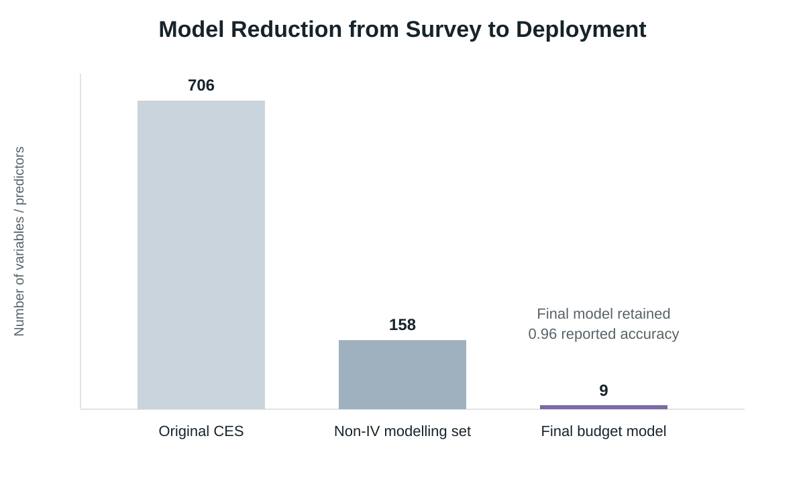
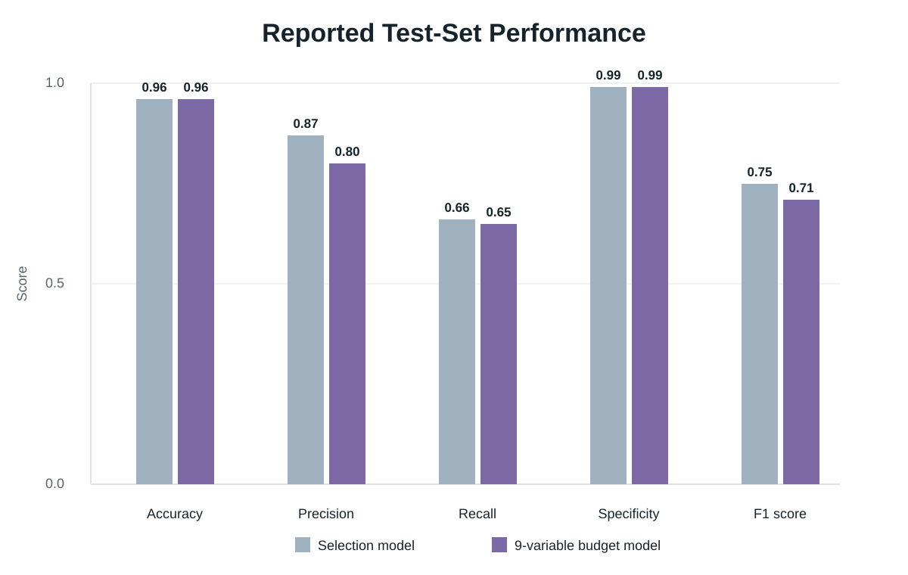

# Voter Turnout Classification in R

A Random Forest classification project using the 2022 Cooperative Election Study to explore how far a high-dimensional survey model could be reduced without drastically degrading predictive performance.

## Project Context

This project was completed for the Applied Social Data Science module of my master's degree.

The starting dataset was the 2022 Cooperative Election Study, containing approximately 60,000 observations across 706 columns. The task was not simply to maximise predictive performance. It was to balance model accuracy against computational cost, information cost and the amount of data required at deployment.

The modelling process therefore had two linked goals:

1. build a strong high-dimensional classification model; and
2. reduce that model to a much smaller set of predictors while retaining most of its predictive value.



## Approach

The original workflow included:

- screening variables for missingness, relevance and deployability
- removing post-election, timing, voter-intention and other unsuitable fields
- comparing models with and without missingness-indicator variables
- imputing retained missing values using the mode, with mean imputation for two continuous percentage-scale variables
- recoding the turnout response into a binary classification target
- using Random Forests for classification and feature selection
- tuning `mtry` with five-fold cross-validation
- comparing tree counts and bootstrap settings
- testing survey weighting
- attempting VSURF feature selection
- iteratively reducing the predictor set using variable importance

The non-indicator dataset was retained as the main modelling dataset because the indicator version did not provide sufficient benefit relative to its additional information cost.

## Final Deployment Model

The final budget model uses nine predictors:

- `birthyr` — birth year
- `votereg` — voter registration status
- `pid3` — party affiliation
- `pid7` — strength of party affiliation
- `CC22_320a` — opinion of the incumbent
- `CC22_320b` — opinion of the US Congress
- `CC22_320c` — opinion of the US Supreme Court
- `ideo5` — political viewpoint
- `newsint` — interest in public/government affairs

The final model used a Random Forest with `mtry = 3` and `ntree = 100`.

### Reported test-set performance

| Metric | Selection model | Final budget model |
|---|---:|---:|
| Accuracy | 0.96 | 0.96 |
| Precision | 0.87 | 0.80 |
| Recall | 0.66 | 0.65 |
| Specificity | 0.99 | 0.99 |
| False positive rate | 0.009 | 0.01 |
| Miss rate | 0.34 | 0.35 |
| F1 score | 0.75 | 0.71 |



The main result is therefore not that the nine-variable model was identical to the larger model, but that a very large reduction in required information produced only a modest deterioration in several classification metrics.

## Deployment vs Experimental Work

The repository deliberately separates the final deployment workflow from the exploratory modelling process.

`R/deployment_model.R` contains only the preparation and modelling required for the final nine-variable classifier.

`R/experimental_appendix.R` contains everything that was useful for model development but is not required at deployment, including:

- missing-data exploration
- broad feature screening
- imputation-indicator experiments
- high-dimensional selection models
- 100-tree vs 500-tree comparisons
- weighted-model testing
- VSURF experimentation
- the intermediate larger budget model

This separation keeps the deployable workflow small while preserving evidence of the modelling process.

## Repository Structure

```text
voter-turnout-classification/
├── README.md
├── R/
│   ├── deployment_model.R
│   └── experimental_appendix.R
├── data/
│   └── README.md
├── images/
│   ├── model_reduction_summary.svg
│   └── model_performance_comparison.svg
├── outputs/
│   └── README.md
└── .gitignore
```

## Data

The raw Cooperative Election Study file is not included in this repository.

To run the code, place the cleaned 2022 CES file at:

```text
data/CCES22_Common_OUTPUT_vv_topost_Clean.csv
```

See `data/README.md` for details.

## Outputs

Running the deployment script writes:

- `outputs/final_model_variable_importance.png`
- `outputs/final_model_metrics.csv`

The reported metrics above come from the original project report. Because the original academic code did not set a random seed, exact train/test results can vary between runs. The cleaned deployment script sets a seed to make future runs reproducible.

## Technologies

- R
- Random Forest
- `caret`
- `randomForest`
- `VSURF` for an experimental feature-selection attempt
- high-dimensional survey data
- classification modelling
- feature selection and model reduction

## Key Learnings

- Predictive performance is only one part of model quality; information and deployment costs also matter.
- High-dimensional models can contain substantial redundancy.
- Variable-importance methods can provide a practical route to model reduction when more computationally expensive selection methods are infeasible.
- A smaller model can be more useful operationally even when it sacrifices some predictive performance.
- Experimental modelling code and deployment code serve different purposes and should be separated clearly.

## Reproducibility Note

This repository is a cleaned portfolio version of an academic project. The modelling choices and reported results are retained from the original work, while duplicated code, machine-specific paths and exploratory sections have been reorganised for readability.

A package lockfile has not been fabricated. If this repository is run in an R environment, `renv::init()` and `renv::snapshot()` can be used to create an environment-specific `renv.lock`.
